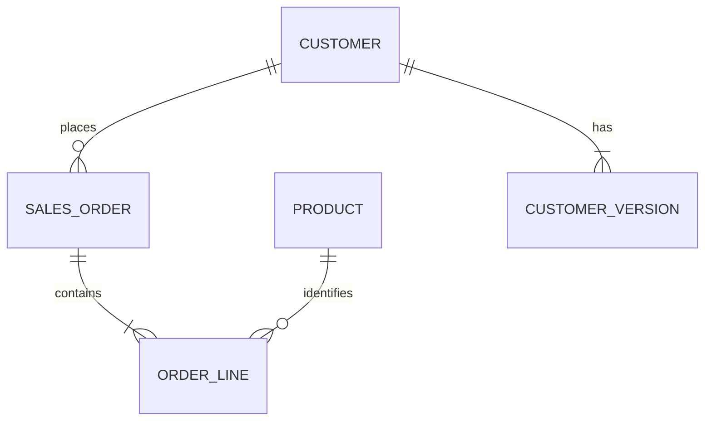

# Enterprise Order Model

A fictional retailer needs to report booked order value by the customer segment in effect on the booking date. This case study models the order domain and implements the reporting slice in Snowflake SQL using synthetic records.

## Business rules

- The fact grain is one booked order line, identified by `(order_id, line_number)`. An order may contain multiple lines.
- Booked value is quantity × booked unit price in USD. Taxes, refunds, cancellations, and currency conversion are outside this slice. Booked value is an order metric.
- Customer segment uses Type 2 history. Validity windows are day-grain, start-inclusive, and end-exclusive. A null end date means the version is open.
- Every line must match exactly one historical customer version before publication. Zero matches indicate missing history and multiple matches indicate overlapping history.



The diagram shows the logical entities. The SQL implements a simplified analytical slice. The staged line carries order date and customer ID from the order header and product ID from the line. Product remains an identifier in this slice. The published view resolves the customer version as of booking.

| Layer | Object | Grain |
| --- | --- | --- |
| Input | `stg_order_line` | One booked line per order and line number |
| History | `dim_customer_version` | One segment version per customer and effective start date |
| Serving | `v_order_line` | One qualified booked line per order and line number |

## Run the demo

Use an empty scratch schema in Snowflake with a role that can create tables and views, and an active warehouse. Run the files in order in the same database and schema.

1. [Create objects](sql/01_schema.sql).
2. [Load synthetic fixtures](sql/02_seed.sql) once in the empty schema.
3. [Build the serving view](sql/03_serving.sql).
4. [Run the data quality checks](sql/04_quality_checks.sql). Each query should return zero rows. Treat any returned row as a release blocker.
5. [Run the segment report](sql/05_segment_report.sql) and compare with the expected results.

| Segment | Order lines | Booked USD |
| --- | ---: | ---: |
| Consumer | 3 | 55.00 |
| Small Business | 1 | 40.00 |
| Total | 4 | 95.00 |

Customer `C001` changes segment on 2025-04-01. The two lines on March order `O100` count separately and resolve to Consumer. April order `O101` falls on the effective-date boundary and resolves to Small Business. The other April order belongs to `C002`, who remains Consumer.

### Exercise a failed release

In the scratch schema, open a transaction and run the following statement. Re-run the checks before rolling back. The overlap check should flag the two affected versions of `C001`, the match check should report two matches for `O101`, and reconciliation should report a missing published line.

```sql
BEGIN;
UPDATE dim_customer_version
SET valid_to = DATE '2025-04-02'
WHERE customer_version_id = 1;
-- Run sql/04_quality_checks.sql here.
ROLLBACK;
```

Snowflake standard-table primary and foreign keys are informational. The SQL checks enforce the release criteria when an operator or deployment workflow uses their results to gate publication. [Snowflake constraint behavior](https://docs.snowflake.com/en/sql-reference/constraints-overview)
